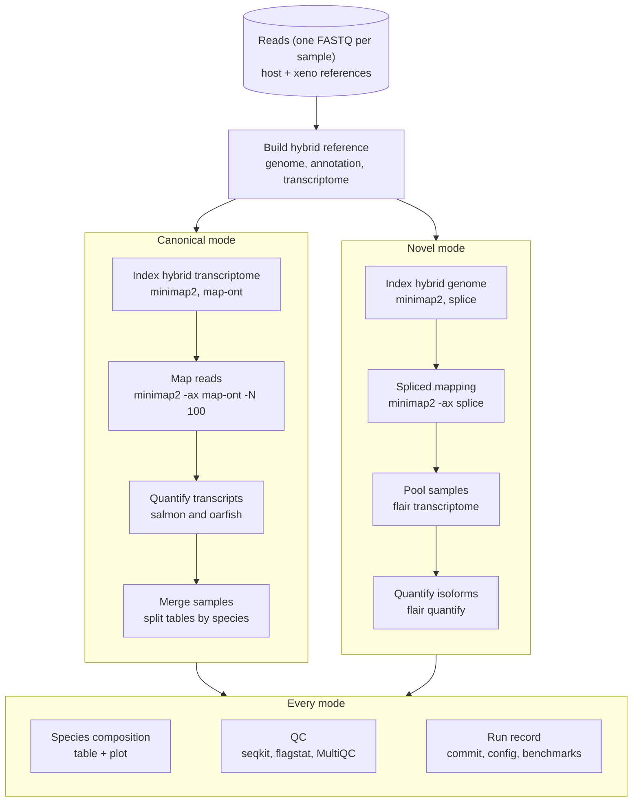
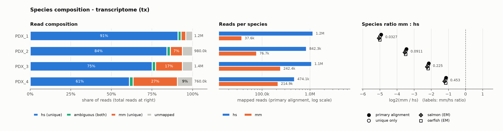

<p align="center">
  <picture>
    <source media="(prefers-color-scheme: dark)" srcset="docs/logo/np_metatx-dark.svg">
    
  </picture>
</p>

<p align="center">
  Snakemake pipeline for <b>meta- and xeno-transcriptomics</b> on Oxford Nanopore long reads.<br>
  It tells you which reads come from which species, and how much each transcript is expressed in each species.
</p>

---

**Contents:**
[Who is it for](#who-is-it-for) ·
[How it works](#how-it-works) ·
[Quick start](#quick-start) ·
[Inputs](#inputs) ·
[Outputs](#outputs) ·
[Reading the species numbers](#reading-the-species-numbers) ·
[Reproducibility](#reproducibility) ·
[Reruns and upgrades](#reruns-and-upgrades) ·
[Resources](#resources) ·
[Troubleshooting](#troubleshooting) ·
[Repository layout](#repository-layout) ·
[Tools and citations](#tools-and-citations)

## Who is it for

Use np_metatx when one sequencing library contains RNA from **two species** and you need to separate them:

- **Xenografts**: a human tumour grown in mouse (PDX), where reads come from both human tumour and mouse stroma.
- **Host and pathogen**: for example human cells infected with *Aspergillus fumigatus*.
- **Any host plus one other organism** with a genome, an annotation and a transcriptome available.

The pipeline expects Oxford Nanopore reads (cDNA or direct RNA) in FASTQ format, one file per sample.

## How it works

### The core idea: competitive mapping

Human and mouse genes are often very similar, so a mouse read can align to a human transcript, and the other way round. If you mapped against each species separately, those reads would be counted twice.

np_metatx instead puts **both species into one reference** and maps every read against it once. Each read goes to the species of its best alignment, and similar alignments in the other species are kept so the read can be flagged:

```text
one read  ──►  hybrid transcriptome (human + mouse transcripts together)

               ENST…    TP53   (human)   alignment score 1450   ◄ best: read counted as "hs"
               ENSMUST… Trp53  (mouse)   alignment score 1380     also found: read flagged "ambiguous"
```

(Scores are illustrative.)

The transcript quantifiers (salmon and oarfish) then use an EM algorithm. It shares reads that fit several transcripts between them according to the overall evidence, instead of giving every read to its single best hit.

### Pipeline overview



### Modes

| Mode | What it does | Use it when |
|------|--------------|-------------|
| `Canonical` (default) | Maps reads to the hybrid **transcriptome** and quantifies known transcripts with salmon and oarfish | You want expression of annotated transcripts per species, for example for differential expression |
| `Novel` | Maps reads to the hybrid **genome** with spliced alignment, then finds isoforms with FLAIR, including unannotated ones | You expect novel isoforms or splicing changes |
| `Both` | Runs both branches on the same samples | You want both answers from one run |

Every mode also writes a **species composition** report and a **MultiQC** QC report.

### Design decisions

These choices explain most of the pipeline's behaviour:

- **Species prefixes on contigs.** GENCODE human and mouse both have a `chr1`, so the hybrid genome and annotation rename contigs to `hs_chr1`, `mm_chr1`, and so on. Transcript IDs are left as they are, because they're already unique per species (`ENST…` vs `ENSMUST…`).
- **`-N 100` in transcriptome mapping.** minimap2 normally keeps only 5 secondary alignments. Long reads from gene families or orthologues can match many transcripts, so up to 100 are kept for the quantifiers to choose from.
- **Unsorted transcriptome BAMs.** salmon and oarfish need all alignments of one read next to each other, which is minimap2's output order. Sorting by position would break that, so these BAMs are left unsorted.
- **Two quantifiers.** salmon and oarfish model long reads differently; oarfish models where along a transcript reads land, which helps with 5′-truncated reads. Running both from the same alignments shows how much the answer depends on the model.
- **One minimap2 index per reference.** The index is built once per run with the same preset used for mapping, instead of once per sample. `-I 16G` keeps it in one part, because multi-part indexes give wrong secondary alignments and mapping qualities.
- **Per-species TPM is rescaled.** TPM normally sums to 1,000,000 over all transcripts. The per-species tables rescale it to 1,000,000 within each species, so a sample's values don't drop just because it contains more of the other species.

## Quick start

**1. Install Snakemake** with conda or mamba. The pipeline is tested with Snakemake 9.11.7; all other tools are installed automatically into separate environments.

```bash
mamba create -n snakemake -c conda-forge -c bioconda "snakemake>=9"
```

```bash
mamba activate snakemake
```

**2. Get the pipeline and make a config** for your project:

```bash
git clone https://github.com/liscruk/np_metatx.git
```

```bash
cd np_metatx && cp config/config.default.yml config/config_myproject.yml
```

Edit `config/config_myproject.yml` as described in [Inputs](#inputs). Project configs in `config/` are ignored by git; only the template is tracked.

**3. Check the plan with a dry run.** This validates the config and the reference files, then lists the jobs without running anything:

```bash
snakemake -s workflow/snakefile --configfile config/config_myproject.yml --use-conda -n
```

**4. Run it:**

```bash
snakemake -s workflow/snakefile --configfile config/config_myproject.yml --use-conda --cores 10
```

The first run also builds the conda environments, which takes a while. To share environments between projects, add `--conda-prefix ~/snakemake-envs`.

**5. Look at these first:**

1. `qc/multiqc/multiqc_report.html`: read quality, mapping rates and quantification summaries for all samples.
2. `species/tx/species_composition.png` (or `species/gn/…`): how many reads came from each species.
3. `counts/salmon/by_species/<species>.numreads.tsv`: per-species count tables, ready for differential expression.

## Inputs

### Config file

Everything is set in one YAML file. This example is a human tumour grown in mouse:

```yaml
experiment: "PDX_2026"                 # free-text name of the run
results: "/data/pdx_2026/analysis/"    # output folder; must end with "/"
threads: 10                            # threads per job
species: ["hs", "mm"]                  # host tag first, xeno tag second (letters and digits only)
mode: "Canonical"                      # Canonical, Novel or Both (any capitalisation)

# Host reference (here: human, GENCODE 47)
hostSeq: "/refs/human/GRCh38.primary_assembly.genome.fa.gz"
hostGtf: "/refs/human/gencode.v47.annotation.gtf.gz"
hostTx:  "/refs/human/gencode.v47.transcripts.fa.gz"

# Xeno / pathogen reference (here: mouse, GENCODE M36)
XenoSeq: "/refs/mouse/GRCm39.primary_assembly.genome.fa.gz"
XenoGtf: "/refs/mouse/gencode.vM36.annotation.gtf.gz"
XenoTx:  "/refs/mouse/gencode.vM36.transcripts.fa.gz"

# Samples: name -> reads file
samples:
  PDX_1: "/data/pdx_2026/reads/PDX_1.fq.gz"
  PDX_2: "/data/pdx_2026/reads/PDX_2.fq.gz"
```

| Key | Required | Meaning |
|-----|----------|---------|
| `experiment` | no | Free-text name, recorded with each run |
| `results` | yes | Output folder, ending with `/` |
| `threads` | no (default 8) | Threads given to each multi-threaded job |
| `species` | yes | Two short tags, host first. They become contig prefixes (`hs_chr1`) and file names (`hs.tpm.tsv`) |
| `mode` | no (default `Canonical`) | `Canonical`, `Novel` or `Both` |
| `hostSeq`, `hostGtf`, `hostTx` | yes | Host genome FASTA, annotation GTF and transcriptome FASTA |
| `XenoSeq`, `XenoGtf`, `XenoTx` | yes | The same three files for the second species |
| `samples` | yes | Sample name → reads file |

<details>
<summary><b>Example: human host + <i>Aspergillus fumigatus</i></b></summary>

```yaml
species: ["hs", "af"]

hostSeq: "/refs/human/GRCh38.primary_assembly.genome.fa.gz"
hostGtf: "/refs/human/gencode.v47.annotation.gtf.gz"
hostTx:  "/refs/human/gencode.v47.transcripts.fa.gz"

XenoSeq: "/refs/afum/Af293.genome.fa"
XenoGtf: "/refs/afum/Af293.annotation.gtf"      # converted from GFF3, see below
XenoTx:  "/refs/afum/Af293.transcripts.fa"
```

Fungal annotations are often only available as GFF3. Convert them to GTF with gffread, then check that the attributes contain `gene_id "…"`. gffread isn't part of the pipeline's environments, so install it first:

```bash
mamba install -c conda-forge -c bioconda gffread
```

```bash
gffread Af293.annotation.gff3 -T -o Af293.annotation.gtf
```

</details>

### Reference files

| File | Format | Notes |
|------|--------|-------|
| Genome (`hostSeq`, `XenoSeq`) | FASTA, plain or `.gz` | Primary assembly recommended; used to build the hybrid genome |
| Annotation (`hostGtf`, `XenoGtf`) | **GTF**, plain or `.gz` | GFF3 is not supported. Needed by Novel mode (FLAIR) and to build the hybrid annotation |
| Transcriptome (`hostTx`, `XenoTx`) | FASTA, plain or `.gz` | Transcript IDs must not overlap between the two species. GENCODE human (`ENST…`) and mouse (`ENSMUST…`) are fine |

The genome, annotation and transcriptome of one species should come from the same release, so transcript IDs match between the GTF and the transcript FASTA.

### Reads

- One FASTQ file per sample, plain or gzipped. cDNA and direct RNA reads both work in Canonical mode. Novel mode maps with minimap2's cDNA splice settings; FLAIR recommends `-uf -k14` for direct RNA, which the pipeline doesn't set yet.
- If a sample was sequenced on several flow cells, join the files first. Gzipped files can simply be concatenated:

  ```bash
  cat PDX_1_run1.fq.gz PDX_1_run2.fq.gz > PDX_1.fq.gz
  ```

- Sample names may contain letters, digits, `_` and `-`, and must start with a letter or digit. Dots aren't allowed because they separate parts of output file names.

### What is checked before anything runs

The config is validated against [`workflow/schemas/config.schema.yaml`](workflow/schemas/config.schema.yaml), and the first lines of each reference are read to confirm it's FASTA or GTF. Mistakes stop the run immediately with a message like these:

| Mistake | Message |
|---------|---------|
| Transcriptome FASTA given as `hostGtf` | `Config 'hostGtf': /refs/human/gencode.v47.transcripts.fa does not look like a GTF file (9 tab-separated columns, gene_id "..." attributes; GFF3 is not supported).` |
| GTF given as a FASTA key | `Config 'XenoTx': … does not look like a FASTA file (first line should start with '>').` |
| Sample lines not indented under `samples:` | `Config 'samples' is empty. List each sample on its own line, indented below 'samples:', …` |
| `results` without the trailing slash | `ValidationError: '/data/pdx_2026/analysis' does not match '/$'` |
| Unknown mode | `ValidationError: 'Fast' does not match '^(?i:canonical\|novel\|both)$'` |
| Old key names `hg38Seq` / `hg38Gtf` / `hg38Tx` | `Config keys hg38Seq/hg38Gtf/hg38Tx were renamed to hostSeq/hostGtf/hostTx. Please update your config.` |

Missing files are reported by Snakemake itself as `MissingInputException`.

## Outputs

All outputs go to the `results` folder. `<sp>` stands for a species tag from the config (for example `hs` or `mm`), and `<hs.mm>` for both tags joined.

```text
results/
├── refs/                                  hybrid references, built once per results folder
│   ├── Hybrid_genome.<hs.mm>.fa(.fai)     both genomes, contigs prefixed (hs_chr1, mm_chr1, …)
│   ├── Hybrid_annotation.<hs.mm>.gtf      both annotations, same prefixes
│   ├── Hybrid_transcriptome.<hs.mm>.fa    both transcriptomes, IDs unchanged
│   ├── *.mmi                              minimap2 indexes
│   └── tx2species / gn2species.<hs.mm>.tsv   which transcript or contig belongs to which species
│
├── bam/
│   ├── tx/<sample>.bam                    Canonical: transcriptome alignments (read order, unsorted)
│   └── gn/<sample>.bam(.bai)              Novel: spliced genome alignments (sorted, indexed)
│
├── counts/                                Canonical
│   ├── salmon/
│   │   ├── <sample>/quant.sf              per-sample salmon output
│   │   ├── numreads.tsv                   estimated reads: transcripts × samples, both species
│   │   ├── tpm.tsv                        TPM: transcripts × samples, both species
│   │   └── by_species/
│   │       ├── <sp>.numreads.tsv          estimated reads for one species (values unchanged)
│   │       └── <sp>.tpm.tsv               TPM rescaled to 1e6 within that species
│   └── oarfish/
│       ├── <sample>/<sample>.quant        per-sample oarfish output (+ .meta_info.json, .ambig_info.tsv)
│       ├── numreads.tsv, tpm.tsv          same layout as salmon; TPM computed by the pipeline (see below)
│       └── by_species/                    same layout as salmon
│
├── flair/                                 Novel
│   ├── merged.bam(.bai)                   all samples pooled for isoform discovery
│   ├── reads_manifest.tsv                 sample → reads list given to flair quantify
│   ├── <hs.mm>.isoforms.{bed,gtf,fa}      one isoform set for the experiment (annotated + novel)
│   ├── <hs.mm>.quant.counts.tsv           isoform counts per sample
│   ├── <hs.mm>.quant.tpm.tsv              isoform TPM per sample
│   └── tmp/                               flair quantify working files
│
├── species/<tx|gn>/                       tx = Canonical, gn = Novel
│   ├── <sample>.counts.tsv                reads per species for one sample
│   ├── species_summary.tsv                all samples, percentages and ratios
│   └── species_composition.pdf / .png     the plot shown below
│
├── qc/
│   ├── seqkit/<sample>.tsv                read count, length, N50, quality
│   ├── flagstat/<sample>.<tx|gn>.flagstat mapping statistics
│   ├── oarfish/oarfish_mqc.tsv            oarfish summary table for MultiQC (Canonical)
│   └── multiqc/multiqc_report.html        one report for everything above (+ multiqc_report_data/)
│
├── logs/                                  stdout/stderr of every job: <rule>.log, or <rule>/<sample>.log per sample
├── benchmarks/                            runtime and memory of every job (Snakemake's per-job files)
│   └── benchmarks.tsv                     all jobs in one table, with the run and commit that ran them
└── run_info/                              which code and config produced the results
```

### Which file answers my question?

| Question | File |
|----------|------|
| Which genes or transcripts change between conditions, per species? | `counts/salmon/by_species/<sp>.numreads.tsv` (or `oarfish/`) as input for DESeq2 or edgeR |
| How highly is a transcript expressed? | `counts/<salmon\|oarfish>/by_species/<sp>.tpm.tsv` |
| How much of each sample is host vs xeno? | `species/tx/species_summary.tsv` and `species_composition.png` |
| Is the data good enough? | `qc/multiqc/multiqc_report.html` |
| Are there unannotated isoforms? | `flair/<hs.mm>.isoforms.gtf` (Novel mode) |
| Which commit produced this result? | `benchmarks/benchmarks.tsv`, see [Reproducibility](#reproducibility) |

### File formats

The excerpts below come from a small test run on synthetic reads, so the values themselves don't mean anything biologically.

**Count and TPM tables** (`numreads.tsv`, `tpm.tsv`, `by_species/*.tsv`) have one row per transcript and one column per sample. They're tab-separated:

```text
Name                                                                     s1        s2
ENST00000831414.1|ENSG00000310526.1|-|-|WASH7P-294|WASH7P|2410|lncRNA|    179.253   179.945
ENST00000831261.1|ENSG00000310526.1|-|-|WASH7P-242|WASH7P|1970|lncRNA|    215.048   0
```

Counts are **estimated** reads, so they can be fractional. Round them before tools that need whole numbers, such as `DESeqDataSetFromMatrix` in DESeq2. To use tximport instead, point it at the per-sample `quant.sf` or `.quant` files.

> **Transcript names keep the full GENCODE FASTA header**, with fields separated by `|`: transcript ID, gene ID, two Havana IDs, transcript name, gene name, length and biotype. To get plain transcript IDs, keep the text before the first `|` in the first column:
>
> ```bash
> awk 'BEGIN{FS=OFS="\t"} {sub(/\|.*/, "", $1)} 1' counts/salmon/by_species/hs.numreads.tsv > hs.numreads.ids.tsv
> ```
>
> In R: `rownames(x) <- sub("\\|.*", "", rownames(x))`

**Per-sample species counts** (`species/tx/<sample>.counts.tsv`):

```text
sample  space  total  unmapped  hs   mm   amb_hs  amb_mm
s1      tx     1500   0         747  753  0       0
```

**Read statistics** (`qc/seqkit/<sample>.tsv`, shortened):

```text
file  format  num_seqs  sum_len  min_len  avg_len  max_len  N50  Q20(%)  Q30(%)  AvgQual
s1    FASTQ   1500      1050000  700      700.0    700      700  100     0       20.00
```

## Reading the species numbers

The species report looks like this. **The numbers in this figure are made up for illustration**: four xenograft samples with increasing mouse content.



- **Read composition** shows each sample's reads as shares: unique to the host, ambiguous (aligned to both species), unique to the xeno, and unmapped. The total read count is at the right.
- **Reads per species** shows mapped reads per species on a log scale, so small xeno fractions stay visible.
- **Species ratio** shows xeno : host as log2. In the transcriptome report (`tx`) each sample has four estimates; the genome report (`gn`) has only the first two, because salmon and oarfish don't run in Novel mode:
  - **Primary alignment**: each read goes to the species of its best hit.
  - **Unique only**: ambiguous reads are left out, which gives a more conservative estimate.
  - **salmon and oarfish (EM)**: the quantifiers' estimated reads, summed per species.

  When the estimates agree, the species call is robust. When they spread apart, many reads fall on conserved genes, and the EM estimates are usually the better guide.

### `species_summary.tsv` columns

Column names use your species tags; here host = `hs` and xeno = `mm`.

| Column | Meaning |
|--------|---------|
| `sample`, `space` | Sample name; `tx` (transcriptome, Canonical) or `gn` (genome, Novel) |
| `total` | Reads in the BAM, including unmapped reads (supplementary alignments are not counted) |
| `unmapped` | Reads with no alignment |
| `hs`, `mm` | Reads whose best (primary) alignment is in that species |
| `amb_hs`, `amb_mm` | Of those, reads that also align to the other species |
| `mapped` | `hs + mm` |
| `uniq_hs`, `uniq_mm` | Reads aligning to one species only (`hs − amb_hs`) |
| `ambiguous` | `amb_hs + amb_mm` |
| `pct_mapped` | Mapped reads as % of `total` |
| `pct_mm_of_mapped` | Xeno reads as % of mapped reads |
| `ratio_mm_hs` | `mm / hs` by primary alignment |
| `ratio_uniq_mm_hs` | `uniq_mm / uniq_hs` |
| `salmon_hs`, `salmon_mm`, `ratio_salmon_mm_hs` | salmon estimated reads per species and their ratio (`tx` only) |
| `oarfish_hs`, `oarfish_mm`, `ratio_oarfish_mm_hs` | The same for oarfish (`tx` only) |

### Things to keep in mind

- **TPM share is not read share.** TPM corrects for transcript length, so the share of TPM per species differs from the share of reads. For "what fraction of the sample is mouse", use `species_summary.tsv`.
- **Use per-species tables for statistics.** Analyse `by_species/<sp>.numreads.tsv` for each species separately and normalise it on its own. Otherwise a change in xeno content looks like a change in host expression.
- **salmon and oarfish TPM aren't directly comparable.** oarfish reports only estimated reads, so the pipeline computes its TPM from those reads and the full transcript length. salmon's TPM uses effective length instead. Compare TPM within one quantifier, not between them.
- **Ambiguity is always 0 in `gn`.** Novel mode maps with `--secondary=no`, as FLAIR recommends, so there are no secondary alignments to flag ambiguous reads with.
- **Novel mode output is not split by species yet.** In `flair/<hs.mm>.isoforms.gtf`, the species is in the contig prefix of the first column (`hs_chr1`, `mm_chr1`).

## Reproducibility

Every run is recorded in `results/run_info/`, so you can always tell which code and settings produced a result.

| File | Content |
|------|---------|
| `runs.tsv` | One row per run: ID, start and end time, status, commit, branch, whether the code had uncommitted changes, name of the stored config snapshot, Snakemake version, mode |
| `config.<hash>.yml` | The exact resolved config of a run, including defaults and `--config` overrides. Stored once per distinct config |
| `<run_id>.patch` | Uncommitted changes under `workflow/` at the time of the run, only for runs marked dirty |

```text
run_id                started                   finished                  status   commit         branch  dirty  config               snakemake  mode
20261123T154628-6290  2026-11-23T15:46:28+0100  2026-11-23T15:47:08+0100  success  1162bf0-dirty  main    yes    config.beffb9ed.yml  9.11.7     Canonical
```

- `status` is `success`, `error` or `running`. A run stopped with Ctrl-C, or one where a job failed, is `error`. `interrupted` means the Snakemake process died without cleaning up (for example `kill -9`, out of memory, or a cluster time limit); it's set when the next run starts.
- A commit ending in `-dirty` means the code had uncommitted changes, which are saved in the patch file.
- `unknown` means the pipeline wasn't running from a git checkout.
- Dry runs and runs with nothing to do aren't recorded.
- The MultiQC report header names the run (and its commit) that last built the report. The data in it may come from earlier runs; `benchmarks.tsv` has the run for each step.

### Which commit produced a file?

A rerun often rebuilds only some steps, so different files in one results folder can come from different commits. `benchmarks/benchmarks.tsv` has one row per job, and a rerun replaces that job's row. `space` and `sample` are `NA` for jobs that aren't split that way; for `splitBySpecies`, `sample` holds the quantifier (`salmon` or `oarfish`):

```text
rule         space  sample  run_id                commit         s       h:m:s    max_rss  …  cpu_time
mapping      NA     s1      20261123T154628-6290  1162bf0-dirty  5.1743  0:00:05  NA       …  0
salmonQuant  NA     s1      20261123T154628-6290  1162bf0-dirty  1.4134  0:00:01  NA       …  0
```

To trace a file back to its code:

1. Find the rule that wrote the file (see [Outputs](#outputs) or the rule files) and look up its row in `benchmarks.tsv`.
2. Check out that `commit`, or for a `-dirty` commit, check it out and apply the patch:

   ```bash
   git checkout 1162bf0 && git apply results/run_info/20261123T154628-6290.patch
   ```

3. Use the config listed for that `run_id` in `runs.tsv`.

The table is updated at the end of each run, and each job is credited to the run during which it finished, so jobs completed by an `interrupted` run still show that run. Memory shows `NA` for jobs that finished before Snakemake took its first memory sample. Jobs from before tracking existed, or from runs started with `--no-hooks`, show `unknown`.

The per-job files in `benchmarks/` stay next to the table: Snakemake counts them as job outputs, so don't delete them, or it will rerun those jobs when you name their rule as a target.

## Reruns and upgrades

Snakemake reruns a step when its inputs, parameters or code change. After updating the pipeline, this can rebuild steps whose results wouldn't change. To rerun only when input files are newer than outputs, add:

```bash
--rerun-triggers mtime
```

Always check with a dry run (`-n`) first.

<details>
<summary><b>Upgrading an existing results folder</b></summary>

Some outputs moved between versions. Move existing files to the new place to avoid recomputing them, then dry-run with `--rerun-triggers mtime` and check that no mapping or quantification jobs are listed.

| Change | Old | New | What to do |
|--------|-----|-----|-----------|
| Host config keys renamed | `hg38Seq`, `hg38Gtf`, `hg38Tx` | `hostSeq`, `hostGtf`, `hostTx` | Rename the keys in your config |
| Filename typo fixed | `refs/Hybrd_transcriptome.*` | `refs/Hybrid_transcriptome.*` | Rename the file, or let it rebuild |
| flagstat moved | `bam/<tx\|gn>/<sample>.txt` | `qc/flagstat/<sample>.<tx\|gn>.flagstat` | Nothing; it's quick to recompute |
| salmon moved | `counts/<sample>/`, `counts/tx/*.tsv` | `counts/salmon/<sample>/`, `counts/salmon/*.tsv` | Move the folders, or let salmon rerun |
| oarfish per-sample folders | `counts/oarfish/<sample>.quant` | `counts/oarfish/<sample>/<sample>.quant` | Run the command below |
| Benchmark table added | `benchmarks/<rule>/…` | the same files, plus `benchmarks/benchmarks.tsv` | Nothing; existing files are added at the end of the next run. Per-job files deleted by commit `8f14442` are written back from the table at the end of the next run that has jobs to do. Until then, naming a rule as a target can rerun it |

Move oarfish outputs into per-sample folders:

```bash
cd results/counts/oarfish && for f in *.quant; do s="${f%.quant}"; mkdir -p "$s" && mv "$s".quant "$s".meta_info.json "$s".ambig_info.tsv "$s"/; done
```

</details>

## Resources

- **Memory:** building and loading the minimap2 index of the hybrid **genome** (Novel mode) needs the most memory, because two mammalian genomes are indexed together in one part. The transcriptome index (Canonical mode) is much smaller.
- **Disk:** transcriptome BAMs keep up to 100 alignments per read, so they're much larger than genome BAMs. In our test data there were about 8 alignment records per read.
- **Threads:** `threads` applies to each job; `--cores` limits the total, so with `--cores 20` and `threads: 10` two samples map at the same time.
- **Your own numbers:** after the first run, `benchmarks/benchmarks.tsv` lists runtime (`s`) and peak memory (`max_rss`, in MB) for every job. Use these to size cluster jobs or plan larger runs.

## Troubleshooting

<details>
<summary><b>"Directory cannot be locked"</b></summary>

Another Snakemake process is using this folder, or an earlier run was killed. If you're sure nothing else is running:

```bash
snakemake -s workflow/snakefile --configfile config/config_myproject.yml --unlock
```

</details>

<details>
<summary><b>Everything reruns after updating the pipeline</b></summary>

Snakemake noticed changed rule code or parameters. Add `--rerun-triggers mtime` (see [Reruns and upgrades](#reruns-and-upgrades)) and dry-run first.

</details>

<details>
<summary><b>A job failed</b></summary>

Each job writes its output to `logs/`: per-sample jobs to `logs/<rule>/<sample>.log` (for example `logs/salmonQuant/PDX_1.log`), others to `logs/<rule>.log`. Snakemake's own log is in `.snakemake/log/` in the folder you ran from. The run is still recorded in `run_info/runs.tsv` with status `error`, and finished jobs keep their benchmark rows.

</details>

<details>
<summary><b>The MultiQC report has no salmon or oarfish section</b></summary>

Those sections exist only in Canonical and Both modes. Novel mode reports seqkit and flagstat only.

</details>

<details>
<summary><b>Transcript names are long</b></summary>

They're the full GENCODE FASTA headers. See [File formats](#file-formats) for how to cut them to plain IDs.

</details>

<details>
<summary><b>Conda environments fail to build</b></summary>

Make sure `conda-forge` and `bioconda` are reachable, and try again with `--conda-prefix` pointing to a folder with enough space. The environment files are in `workflow/envs/`. They pin exact tool versions; helper libraries such as pandas and pysam use version ranges.

</details>

## Repository layout

```text
config/config.default.yml       config template (copy it; project configs are git-ignored)
workflow/snakefile              entry point: config checks, mode switch, rule all, hybrid reference (makeRef)
workflow/rules/common.smk       shared settings, paths, reference checks, run-tracking helpers
workflow/rules/canonical.smk    Canonical: transcriptome mapping, salmon, oarfish, species split
workflow/rules/novel.smk        Novel: spliced genome mapping, FLAIR isoform discovery and quantification
workflow/rules/species.smk      species composition tables and plots
workflow/rules/qc.smk           seqkit, samtools flagstat, MultiQC
workflow/rules/tracking.smk     run records and benchmark table
workflow/schemas/               JSON schema for the config
workflow/scripts/               helper scripts (species counts and plots, oarfish merge, species split, tracking)
workflow/envs/                  one conda environment per tool group
docs/                           logo and README images
resources/sequentialMapping.py  experimental sequential host → xeno mapping (not used by the pipeline)
```

<details>
<summary><b>Adding another quantifier</b></summary>

A new quantifier fits in next to salmon and oarfish:

1. Add a rule in `canonical.smk` that reads `bam/tx/{sample}.bam` and writes into `counts/<tool>/<sample>/`.
2. Add a merge rule that writes `counts/<tool>/numreads.tsv` and `tpm.tsv` with a `Name` column plus one column per sample.
3. Add the tool to the `quant` wildcard constraint of `splitBySpecies` and to `CANONICAL_TARGETS`, so it gets per-species tables.
4. To show it in the species ratio plot, edit `workflow/scripts/species_summary.py` and the `speciesSummary` rule in `species.smk`:
   - add a `--<tool>` option next to `--salmon` and `--oarfish`;
   - add the tool to `EM_TOOLS` (files, transcript column, read-count column);
   - add a marker for it to `EM_MARKERS`;
   - add the tool's per-sample files as an input of `speciesSummary` and pass them in its `em` param.

</details>

## Tools and citations

np_metatx is built on these tools. Please cite the ones your analysis used.

| Tool | Version | Used for | Reference |
|------|---------|----------|-----------|
| [Snakemake](https://snakemake.github.io) | 9 | Workflow engine | Mölder et al. (2021) *F1000Research* 10:33 |
| [minimap2](https://github.com/lh3/minimap2) | 2.30 | Read mapping and indexes | Li (2018) *Bioinformatics* 34:3094 |
| [samtools](https://www.htslib.org) | 1.22.1 | BAM handling, flagstat | Danecek et al. (2021) *GigaScience* 10:giab008 |
| [salmon](https://github.com/COMBINE-lab/salmon) | 1.10.3 | Transcript quantification | Patro et al. (2017) *Nature Methods* 14:417 |
| [oarfish](https://github.com/COMBINE-lab/oarfish) | 0.13.0 | Long-read transcript quantification | Zare Jousheghani et al. (2025) *Bioinformatics* 41:i304 |
| [FLAIR](https://github.com/BrooksLabUCSC/flair) | 3.0.1 | Isoform discovery and quantification (Novel) | Tang et al. (2020) *Nature Communications* 11:1438 |
| [bedtools](https://bedtools.readthedocs.io) | 2.31.1 | Used by FLAIR (Novel) | Quinlan & Hall (2010) *Bioinformatics* 26:841 |
| [SeqKit](https://bioinf.shenwei.me/seqkit/) | 2.10.1 | Read statistics | Shen et al. (2016) *PLoS ONE* 11:e0163962 |
| [MultiQC](https://multiqc.info) | 1.33 | QC report | Ewels et al. (2016) *Bioinformatics* 32:3047 |

## License

Apache License 2.0, see [`LICENSE`](LICENSE).
